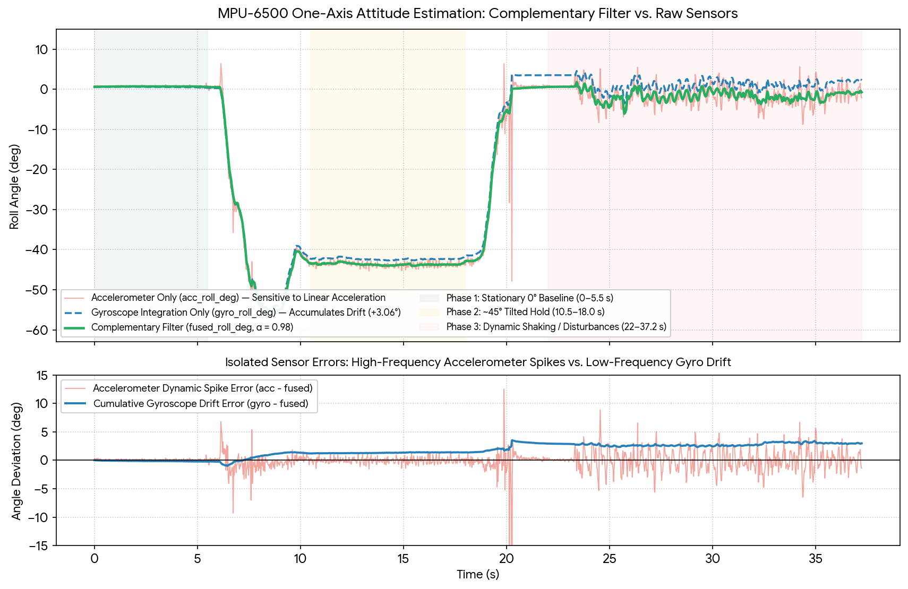

# IMU-Based Attitude Estimation & Control Platform (MPU-6500 / Arduino UNO)

An embedded systems and signal processing project developing a real-time attitude (roll tilt) estimation system on an **Arduino UNO R3** using a 6-axis **MPU-6500 MEMS IMU** over I²C. 

This repository documents the step-by-step engineering progression: hardware identification, six-position static accelerometer calibration, independent holdout tilt validation, gyroscope zero-rate bias compensation, and real-time discrete-time **Complementary Filter** sensor fusion.

---

## 1. Hardware & I²C Configuration

* **Microcontroller:** Arduino UNO R3 (ATmega328P)
* **Sensor:** InvenSense MPU-6500 6-Axis IMU (`WHO_AM_I` register `0x75` verified as `0x70`, I²C address `0x68`)
* **Interface:** Direct register-level I²C transactions using `<Wire.h>` (burst reads starting at `ACCEL_XOUT_H` `0x3B`, 16-bit signed two's complement reconstruction) without external black-box sensor libraries.

| MPU-6500 Pin | Arduino UNO Pin | Function |
| :--- | :--- | :--- |
| `VCC` | `5V` | Power supply (via onboard breakout regulator) |
| `GND` | `GND` | Common ground reference |
| `SDA` | `A4 (SDA)` | I²C Serial Data |
| `SCL` | `A5 (SCL)` | I²C Serial Clock |

---

## 2. Six-Position Accelerometer Calibration

Using `firmware/accelerometer_average/accelerometer_average.ino` (averaging $N = 200$ samples per static orientation), raw 16-bit accelerometer readings were recorded across six orthogonal orientations (`data/accelerometer-six-position.txt`) to estimate per-axis zero-$g$ bias and sensitivity scale factors ($\pm 2g$ full-scale range, nominal $16384\text{ counts}/g$):

$$a_i = \frac{\text{raw}_i - \text{bias}_i}{\text{scale}_i} \quad [g]$$

| Axis | Estimated Bias (counts) | Empirical Scale Factor (counts/$g$) | Nominal $\pm 2g$ Scale |
| :--- | ---: | ---: | ---: |
| **X** | $+263.74$ | $16427.78$ | $16384$ |
| **Y** | $+276.66$ | $16405.48$ | $16384$ |
| **Z** | $-697.16$ | $16627.08$ | $16384$ |

### Holdout Tilt & Gravity-Vector Validation (`accelerometer_angle.ino`)
To avoid circular validation on the calibration poses alone, the calibrated gravity vector norm $\|a\| = \sqrt{a_x^2 + a_y^2 + a_z^2}$ and static roll angle $\theta_{\text{acc}} = \text{atan2}(a_y, a_z) \cdot \frac{180}{\pi}$ were tested across independent static and dynamic conditions:

* **Horizontal Baseline ($0^\circ$):** $a_x = -0.02g, a_y = 0.00g, a_z = 1.03g \rightarrow \|a\| = 1.03g$, $\theta_{\text{acc}} \in [-0.3^\circ, +0.4^\circ]$.
* **Independent $\approx -45^\circ$ Holdout Tilt:** $a_x = 0.00g, a_y = -0.72g, a_z = 0.72g \rightarrow \|a\| = 1.02g$, $\theta_{\text{acc}} = -45.0^\circ$ (matching theoretical $\sin 45^\circ \approx 0.707g$ equal-axis projection).
* **Vertical Edge ($\approx -90^\circ$, resting on header pins):** $a_x = -0.01g, a_y = -1.00g, a_z = 0.10g \rightarrow \|a\| = 1.00g$, $\theta_{\text{acc}} = -84.3^\circ$.
* **Dynamic Shaking Disturbance:** Rapid hand acceleration saturated the $\pm 2g$ full-scale range ($a_x, a_y \approx 1.98g$, $\|a\| = 3.40g$), corrupting the accelerometer-only tilt estimate to $134.2^\circ$ and motivating gyroscope sensor fusion.

---

## 3. Complementary Sensor Fusion & Experimental Results

Implemented in `firmware/complementary_filter/complementary_filter.ino`, the estimator performs a 500-sample stationary gyroscope bias calibration at startup, tracks loop execution intervals $\Delta t$ via `micros()` (effective sampling rate $41.87\text{ Hz}$, mean $\Delta t = 23.88\text{ ms}$), and fuses gyroscope integration with accelerometer gravity reference ($\alpha = 0.98$):

$$\theta_{\text{fused}}[k] = \alpha \left(\theta_{\text{fused}}[k-1] + \omega_x[k]\Delta t\right) + (1 - \alpha)\theta_{\text{acc}}[k]$$

### Key Measured Performance Metrics (`data/complementary_filter_log.csv`, 1560 samples / 37.2 s)

| Experimental Phase | Accelerometer Only (`acc_roll_deg`) | Gyroscope Only (`gyro_roll_deg`) | Complementary Filter (`fused_roll_deg`) | Key Engineering Observation |
| :--- | :--- | :--- | :--- | :--- |
| **Phase 1: Stationary Baseline ($0\text{–}5.5\text{ s}$)** | Mean: $+0.74^\circ$ Std: $0.142^\circ$ | Mean: $+0.55^\circ$ Std: $0.056^\circ$ | Mean: $+0.69^\circ$ Std: **$0.030^\circ$** | **$4.69\times$ reduction** in stationary RMS noise vs. raw accelerometer. |
| **Phase 2: Tilted Hold ($10.5\text{–}18.0\text{ s}$)** | Mean: $-43.68^\circ$ Std: $0.560^\circ$ | Mean: $-42.34^\circ$ *(drifting)* | Mean: **$-43.66^\circ$** Std: **$0.239^\circ$** | Accurately tracks $-43.7^\circ$ hold while reducing hand-tremor variance by **$2.35\times$**. |
| **Phase 3: Impact & Shaking ($20.0\text{–}37.2\text{ s}$)** | Spike up to **$-47.85^\circ$** Std: $2.28^\circ$ | Accumulated drift: **$+3.06^\circ$** ($+0.085^\circ/\text{s}$) | Mean: $-1.44^\circ$ Std: **$1.35^\circ$** | Rejects $-48.0^\circ$ table-impact acceleration spike and eliminates cumulative gyro drift. |

---

## 4. Repository Structure

* `firmware/accelerometer_average/accelerometer_average.ino` — 200-sample averaging sketch for static 6-position calibration.
* `firmware/accelerometer_angle/accelerometer_angle.ino` — Calibrated $g$-unit conversion, vector norm verification, and `atan2` roll estimation.
* `firmware/complementary_filter/complementary_filter.ino` — Startup gyro bias calibration, `micros()` integration, and real-time complementary filter with CSV serial telemetry.
* `data/` — Recorded 6-orientation calibration dataset and 1560-sample (`41.9 Hz`) real-time sensor fusion CSV log.
* `results/plots/` — Time-series comparison and isolated sensor error plots.

## 5. Next Steps (Milestone D)
* Design a mechanically constrained 1-DOF tiltable test rig with an SG90 servo actuator and separate power supply to close an external P/PD attitude stabilisation loop.